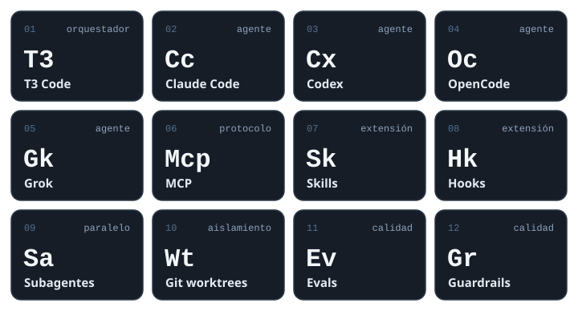
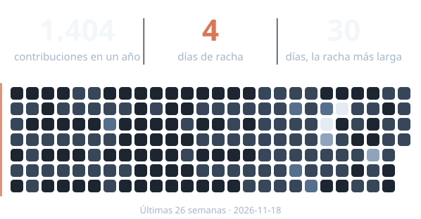

<a href="https://x.com/pabsalme">
  <picture>
    <source media="(prefers-color-scheme: dark)" srcset="assets/cabecera-dark.svg">
    <source media="(prefers-color-scheme: light)" srcset="assets/cabecera-light.svg">
    
  </picture>
</a>

  

&nbsp;

&nbsp;

 

Monto cosas con Claude Code. Agentes y automatizaciones que uso yo en mi día a día, no demos.

Uso la IA más que nunca, pero me cansa ver la misma noticia contada con otra cara. Me interesa lo que pasa cuando la pones a trabajar de verdad: lo que sale, lo que falla y lo que sorprende.

## En qué ando

  <picture>
    <source media="(prefers-color-scheme: dark)" srcset="assets/terminal-dark.svg">
    <source media="(prefers-color-scheme: light)" srcset="assets/terminal-light.svg">
    
  </picture>

 

- **Claude Code**, a diario y para casi todo.
- **Agentes** que me quitan trabajo de encima: inventario, correo, calendario.
- **Automatización** de lo que hago más de dos veces.

## Con qué

  <picture>
    <source media="(prefers-color-scheme: dark)" srcset="assets/stack-dark.svg">
    <source media="(prefers-color-scheme: light)" srcset="assets/stack-light.svg">
    
  </picture>

## Actividad

Casi todo lo que monto vive en repos privados. Aquí se ve el ritmo.

  <picture>
    <source media="(prefers-color-scheme: dark)" srcset="assets/actividad-dark.svg">
    <source media="(prefers-color-scheme: light)" srcset="assets/actividad-light.svg">
    
  </picture>

## Qué hay en este GitHub

Sobre todo apuntes y ejercicios de cuando estudiaba. Lo que monto ahora todavía no está aquí.

| Repo | Qué es |
|---|---|
| [aws-cloud-foundations](https://github.com/pablosalme/aws-cloud-foundations) | Resúmenes de los 10 módulos de AWS Cloud Foundations. |
| [aws-data-engineering](https://github.com/pablosalme/aws-data-engineering) | Apuntes del curso AWS Data Engineering. Archivado. |
| [analisis_datos_python](https://github.com/pablosalme/analisis_datos_python) | Ejercicios de análisis de datos con Python. Archivado. |
| [42madrid](https://github.com/pablosalme/42madrid) | Mi paso por 42 Madrid, en C. Archivado. |

## Dónde encontrarme

Casi todo lo cuento en X. Si quieres decirme algo, escríbeme por ahí.

También hago vídeos de IA aplicada en [Instagram](https://www.instagram.com/pabloinpublic/), y los recursos están en [pabloinpublic.com](https://pabloinpublic.com).

