<a href="https://x.com/pabsalme">
  <picture>
    <source media="(prefers-color-scheme: dark)" srcset="assets/cabecera-dark.svg">
    <source media="(prefers-color-scheme: light)" srcset="assets/cabecera-light.svg">
    
  </picture>
</a>

  

&nbsp;

&nbsp;

 

AI Engineer. Diseño y opero sistemas de agentes de código: un orquestador por proyecto que reparte el trabajo entre agentes de distintos modelos y no integra nada sin revisar.

Me interesa menos el modelo de turno que lo que hay alrededor: cómo se reparte una tarea, quién revisa a quién y qué pasa cuando un agente se equivoca.

## Cómo trabajo

  <picture>
    <source media="(prefers-color-scheme: dark)" srcset="assets/traza-dark.svg">
    <source media="(prefers-color-scheme: light)" srcset="assets/traza-light.svg">
    
  </picture>

 

- **Orquestación multiagente.** Un orquestador por proyecto en T3 Code. No ejecuta: planifica, delega en agentes hijo y revisa lo que entregan.
- **Varios modelos, un mismo reglamento.** Claude, Codex, OpenCode y Grok leen el mismo fichero de reglas. Cambio de proveedor sin reescribir nada.
- **Paralelo y aislado.** Cada agente trabaja en su rama y en su `git worktree`. Nadie pisa a nadie.
- **Revisión cruzada.** Lo que escribe un modelo lo revisa otro antes de integrar.
- **Skills, hooks y MCP.** Los flujos que se repiten pasan a ser skills; los hooks y los servidores MCP dan a los agentes herramientas y límites.
- **Evals y guardrails.** Comprobaciones antes de integrar y reglas que un agente no puede saltarse: nada de secretos, nada de borrar sin confirmar.
- **Sin mí delante.** Tareas programadas y un agente que integra por la noche las ramas que están limpias.

## Con qué

  <picture>
    <source media="(prefers-color-scheme: dark)" srcset="assets/stack-dark.svg">
    <source media="(prefers-color-scheme: light)" srcset="assets/stack-light.svg">
    
  </picture>

## Actividad

Casi todo lo que hago vive en repos privados. Aquí se ve el ritmo.

  <picture>
    <source media="(prefers-color-scheme: dark)" srcset="https://streak-stats.demolab.com/?user=pablosalme&locale=es&hide_border=true&border_radius=12&background=0f141b&stroke=2c3a4a&ring=d97757&fire=d97757&currStreakNum=f4f7fa&sideNums=f4f7fa&currStreakLabel=d97757&sideLabels=8fa3bd&dates=8fa3bd">
    <source media="(prefers-color-scheme: light)" srcset="https://streak-stats.demolab.com/?user=pablosalme&locale=es&hide_border=true&border_radius=12&background=f6f8fa&stroke=cad5e2&ring=c2613f&fire=c2613f&currStreakNum=0f141b&sideNums=0f141b&currStreakLabel=c2613f&sideLabels=556f8d&dates=556f8d">
    
  </picture>

## Repos públicos

Apuntes y ejercicios de formación. El trabajo con agentes todavía no está aquí.

| Repo | Qué es |
|---|---|
| [aws-cloud-foundations](https://github.com/pablosalme/aws-cloud-foundations) | Resúmenes de los 10 módulos de AWS Cloud Foundations. |
| [aws-data-engineering](https://github.com/pablosalme/aws-data-engineering) | Apuntes del curso AWS Data Engineering. Archivado. |
| [analisis_datos_python](https://github.com/pablosalme/analisis_datos_python) | Ejercicios de análisis de datos con Python. Archivado. |
| [42madrid](https://github.com/pablosalme/42madrid) | Mi paso por 42 Madrid, en C. Archivado. |

## Contacto

Lo que voy montando lo cuento en X. Si quieres decirme algo, escríbeme por ahí.

También hago vídeos de IA aplicada en [Instagram](https://www.instagram.com/pabloinpublic/), y los recursos están en [pabloinpublic.com](https://pabloinpublic.com).
